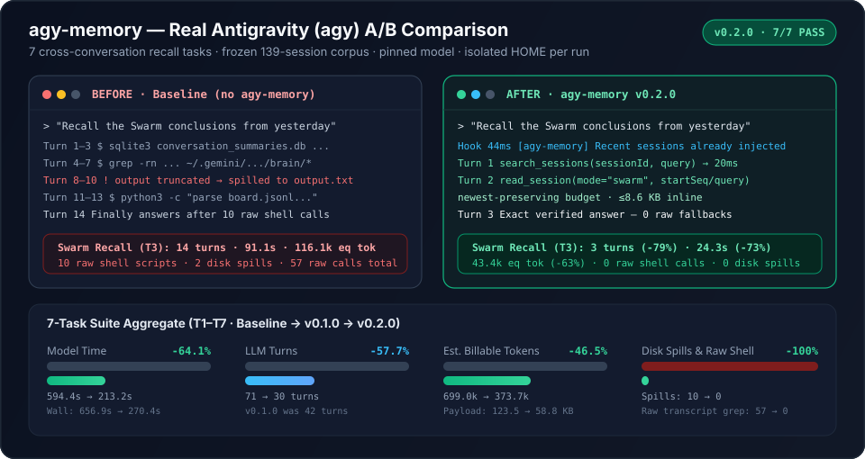

<div align="center">


# agy-memory

**Local zero-dependency cross-conversation memory MCP plugin for Google Antigravity (`agy`)**

[](https://github.com/maxLWS/agy-memory/actions/workflows/ci.yml)
[](https://github.com/maxLWS/agy-memory/releases)
[](LICENSE)
[](package.json)
[](package.json)
[](#quick-start)

English · [简体中文](README.zh-CN.md) · [Quick Start](#quick-start) · [Benchmarks](#real-agy-ab-benchmarks) · [Benchmark Report](docs/BENCHMARK_REPORT.md) · [MCP Tools](#the-5-mcp-tools) · [Security](SECURITY.md)

</div>

---

**`agy-memory`** is a 100% local, zero-runtime-dependency [MCP](https://modelcontextprotocol.io/) plugin for **Google Antigravity** (CLI `agy`, Desktop, and IDE). It gives every conversation fast, structured, token-lean recall over your local Antigravity history — transcripts (with truncated full-reply hydration), Markdown artifacts, Swarm boards, and persistent cross-session notes — without external databases, background LLM summarizers, or cloud sync.

| Model Time | Wall-Clock Time | LLM Turns | Est. Billable Tokens | Disk Spills |
| :---: | :---: | :---: | :---: | :---: |
| **-64.1%** | **-58.8%** | **-57.7%** | **-46.5%** | **10 → 0 (-100%)** |

<p align="center">
  
</p>

*Measured across 7 real cross-conversation recall tasks on a frozen 139-session local corpus (`v0.2.0` vs. baseline without `agy-memory`, pinned model). Full failure analysis (`v0.1.0` → `v0.2.0`): [Benchmark & Iteration Report](docs/BENCHMARK_REPORT.md).*

## Quick Start

**Requirements:** **Node.js >= 20** (no `npm install` needed — pre-built, unminified zero-dependency ESM bundles are shipped in `dist/`). Optional accelerators: Node 22.5+ built-in `node:sqlite` (or `sqlite3`/`python3`) and [`ripgrep` (`rg`)](https://github.com/BurntSushi/ripgrep); pure-JS fallbacks work everywhere when neither is installed.

### One-Command Install

**macOS / Linux:**

```bash
curl -fsSL https://raw.githubusercontent.com/maxLWS/agy-memory/main/install.sh | sh
```

**Windows (PowerShell):**

```powershell
irm https://raw.githubusercontent.com/maxLWS/agy-memory/main/install.ps1 | iex
```

### Or Ask Antigravity to Install It for You

Paste this single sentence into any Antigravity session:

```text
Clone https://github.com/maxLWS/agy-memory.git, run `node scripts/install.mjs install && node scripts/install.mjs doctor` inside it to install and verify the agy-memory plugin, and enable it in agy.
```

<details>
<summary>More install options (local clone, project-only install, manual validation)</summary>

```bash
git clone https://github.com/maxLWS/agy-memory.git
cd agy-memory

# Global install (~/.gemini/config/plugins/agy-memory)
node scripts/install.mjs install

# Or install for a single repository (<repo>/.agents/plugins/agy-memory)
node scripts/install.mjs install --project /path/to/repo

# Verify installation, MCP handshake, SessionStart hook, and agy validation
node scripts/install.mjs doctor
```

</details>

Start a **new** `agy` session after installing; Antigravity automatically discovers and loads the plugin.

## Architecture & Components

| Component | File | Role |
| :--- | :--- | :--- |
| **Plugin Manifest** | [`plugin.json`](plugin.json) | Native Antigravity plugin manifest (`agy plugin validate --strict` clean) |
| **MCP Server (Eager)** | [`mcp_config.json`](mcp_config.json) → [`dist/mcp-server.mjs`](dist/mcp-server.mjs) | Zero-dependency single-file stdio JSON-RPC server (JSONL + LSP framing) and `--cli` fallback |
| **`SessionStart` Hook** | [`hooks.json`](hooks.json) → [`dist/session-start.mjs`](dist/session-start.mjs) | Injects a `<=1.8 KB` read-only snapshot of the current session ID, 5 recent substantive workspace sessions, and pinned notes |
| **Routing Rule** | [`rules/AGENTS.md`](rules/AGENTS.md) | Guides eager `toolSummary` calls, `SessionStart` reuse, hybrid `read_file` on large `.md` artifacts, and authoritative 0-match handling |

## The 5 MCP Tools

All 5 tools are registered as `eager: true` and enforce a strict `<=8,650`-byte UTF-8 inline cap (surrogate-pair safe) so tool returns never trigger Antigravity's `output.txt` disk spills.

1. **`list_sessions`** — Fast read-only catalog listing (cached in-process by SQLite + WAL mtime/size, `<2 ms` warm). Filters by `workspace`, `query` (quoted phrases supported), `minSteps`, `sinceHours`, `excludeSessionId` (prefix or comma-separated list), and `includeChildren`.
2. **`search_sessions`** — Full-text CJK + English search (multi-word AND, quoted phrases, or regex) across transcripts (auto-hydrating `truncated_fields` from `transcript_full.jsonl`), Markdown artifacts (returning full `Path` + line count for direct `read_file`), and Swarm boards. Supports single-session `sessionId` scoping, strict `scope` isolation, automatic exclusion of active in-flight prompts, term-diverse snippet selection, and recency-aware ranking.
3. **`read_session`** — Progressive session reader by full UUID or unambiguous prefix (`>=4` chars):
   - `mode: "digest"` — Chronological overview preserving the opening turns, high-signal middle milestones, tool-only turn summaries, and latest conclusions.
   - `mode: "turns"` — Exact step-range or tail-turn reader with automatic `transcript_full.jsonl` hydration and `charOffset` pagination for >8.2 KB turns.
   - `mode: "artifacts"` — Lists artifacts with line counts/paths or reads exact budget-packed line ranges.
   - `mode: "swarm"` — Newest-preserving budget packing (never chops off the latest conclusions), board-derived agent roster fallback when `members.json` is absent, and `startSeq` / `endSeq` / `query` filters.
4. **`save_note`** — Saves, updates, or deletes curated cross-session notes atomically at `<appDataDir>/plugin_data/agy-memory/notes.json` (never touches Antigravity's internal databases).
5. **`recall_notes`** — Recalls saved notes filtered by `query` (matches ID, topic, content, tags, workspace), `workspace` (preserves global and parent-workspace notes), or `tag`.

## Real `agy` A/B Benchmarks

Evaluated with real `agy -p --output-format json` executions against a frozen 139-session local corpus using isolated per-task `HOME` environments, identical prompts, and a single pinned model (`gemini-3.8-flash-medium`). See the full failure analysis and per-task breakdown in [`docs/BENCHMARK_REPORT.md`](docs/BENCHMARK_REPORT.md).

| Arm | Pass Rate | Model Time | Wall Time | LLM Turns | Tool Calls (`mem` / `raw`) | Uncached Input | Cache Read | Output | Est. Billable Eq\* | Payload KB | Disk Spills |
| :--- | :---: | ---: | ---: | ---: | :---: | ---: | ---: | ---: | ---: | ---: | :---: |
| **Baseline (no `agy-memory`)** | 7/7 (100%) | 594.4s | 656.9s | 71 | 66 (0 / 57) | 380,045 | 1,606,423 | 31,656 | **698,967** | 123.5 KB | 10 |
| **`agy-memory v0.1.0`** | 6/7 (86%) | 282.6s | 488.7s | 42 | 42 (26 / 13) | 282,756 | 900,442 | 18,049 | **463,045** | 89.4 KB | 5 |
| **`agy-memory v0.2.0`** | **7/7 (100%)** | **213.2s** | **270.4s** | **30** | **35 (31 / 2†)** | **255,921** | **484,579** | **13,871** | **373,734** | **58.8 KB** | **0** |
| **`v0.2.0` vs. Baseline** | **100%** | **-64.1%** | **-58.8%** | **-57.7%** | **-47.0%** | -32.7% | -69.8% | -56.2% | **-46.5%** | **-52.4%** | **-100%** |
| **`v0.2.0` vs. `v0.1.0`** | **+14.3pp** | **-24.6%** | **-44.7%** | **-28.6%** | **-16.7%** | -9.5% | -46.2% | -23.1% | **-19.3%** | **-34.2%** | **-100%** |

*\*`Est. Billable Eq = uncached_input + 0.1 * cache_read + 5 * output`. Fixed prompt overhead (`rules/AGENTS.md` + 5 eager schemas + `SessionStart` snapshot) is ~3.1k tokens on turn 1 (cached from turn 2 onward).*  
*†The 2 `raw` tool calls in `v0.2.0` are intentional direct `read_file` calls on Markdown artifact paths (T1 & T4); 0 raw `transcript.jsonl` or SQLite shell fallbacks across all 7 tasks.*

### Local Latency Profile (`v0.1.0` → `v0.2.0`)

- `SessionStart` hook: `101.5 ms → 44.0 ms`
- Warm `list_sessions`: `38.2 ms → 1.1 ms`
- Cold CJK+EN `search_sessions`: `210 ms → 59.8 ms` (warm `20.0 ms`)
- Warm `read_session(digest)` on a 3,400+ step transcript: `79.5 ms → 7.1 ms`

## CLI Mode & Offline Analytics

Because Antigravity Swarm workers do not mount MCP plugins, the bundled server doubles as a standalone CLI:

```bash
node ~/.gemini/config/plugins/agy-memory/dist/mcp-server.mjs --cli list --workspace /path/to/repo --min-steps 5 --limit 10
node ~/.gemini/config/plugins/agy-memory/dist/mcp-server.mjs --cli search "rate limiter 缓存击穿"
node ~/.gemini/config/plugins/agy-memory/dist/mcp-server.mjs --cli search --session a1b2c3d4 "singleflight"
node ~/.gemini/config/plugins/agy-memory/dist/mcp-server.mjs --cli read a1b2c3d4 --mode digest
node ~/.gemini/config/plugins/agy-memory/dist/mcp-server.mjs --cli read a1b2c3d4 --mode swarm --tail 25 --query reviewer
node ~/.gemini/config/plugins/agy-memory/dist/mcp-server.mjs --cli note-save --topic "Cache TTL" --content "Keep mutex TTL at 15s" --tags cache,ops
node ~/.gemini/config/plugins/agy-memory/dist/mcp-server.mjs --cli note-recall "TTL"
node ~/.gemini/config/plugins/agy-memory/dist/mcp-server.mjs --cli stats --recent 50
```

## Privacy & Compatibility

- **100% local, zero network calls**: Never sends transcripts, prompts, or notes anywhere. See [`SECURITY.md`](SECURITY.md).
- **Read-only on Antigravity databases**: Opens `conversation_summaries.db` strictly read-only (`node:sqlite` `{ readOnly: true }`, `sqlite3 -readonly`, or Python `?mode=ro`).
- **Works cleanly alongside `agy-fast`**: Independent MCP namespace (`agy-memory_memory`), independent hook, and independent plugin directory.

## Development & Verification

```bash
npm install
npm run typecheck
npm run build
npm test
npm run bench:stress
npm run validate
```

## License

[MIT](LICENSE)
