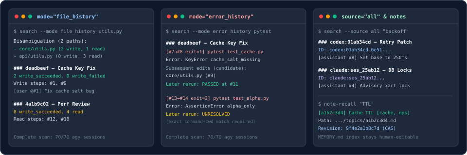
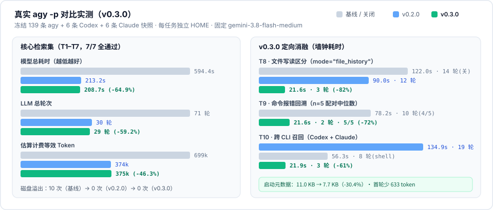

# agy-memory

[English](./README.md)

[](https://github.com/maxLWS/agy-memory/actions/workflows/ci.yml)
[](https://github.com/maxLWS/agy-memory/releases)
[](LICENSE)
[](https://glama.ai/mcp/servers/maxLWS/agy-memory)

**agy-memory** 是面向 Google Antigravity（`agy` CLI、Desktop 与 IDE）的零依赖本地 MCP 插件。不需要外部向量库，也不会上传任何数据，让新对话直接检索和回看本机历史会话：

1. **跨会话检索**：一次查 Antigravity 历史正文（自动补全 `transcript_full.jsonl` 被截断的长回复）、Markdown Artifacts、Swarm 留言板，以及按需只读检索本机 **Codex**（`~/.codex`）和 **Claude Code**（`~/.claude`）记录。
2. **文件与报错回溯**：查某个文件在哪些历史会话里被改写过还是只读过（`mode="file_history"`），或者回查历史命令报错、退出码及后续是否跑通（`mode="error_history"`）。
3. **可编辑 Markdown 笔记**：把长期记忆存成普通 Markdown 文件（`topics/<id>.md` + `MEMORY.md`），带 `expectedRevision` 修订校验防止并发覆盖。

已收录于 [Awesome Antigravity Plugins](https://github.com/biTQ-m/awesome-antigravity-plugins/blob/main/README_CN.md#性能加速工程流与多智能体编排) 的「性能加速、工程流与多智能体编排」分类。 

 ## 整体架构


- **目录与检索（`src/store.ts`、`src/search.ts`）**：以只读方式读取 `conversation_summaries.db`（依次回退 `node:sqlite` / `sqlite3` / Python / 纯 JS），按 mtime 缓存解析结果，并从 `transcript_full.jsonl` 补全被截断的回复。
- **轨迹解析与跨 CLI 适配（`src/trace.ts`、`src/adapters.ts`）**：按字节偏移流式读取 JSONL（单次上限 32 MB / 2.5 s），对文件写入与同命令复跑做正向确认；通过规范 ID（`codex:<id>`、`claude:<id>`）隔离本机 Codex / Claude 会话。
- **笔记与内联预算（`src/notes.ts`、`src/snapshot.ts`）**：5 个 MCP 工具返回严格控制在 `<=8,650` UTF-8 字节以内，避免 `output.txt` 落盘溢出；`SessionStart` 启动钩子保持纯只读，注入 `<=1.8 KB` 轻量快照。

## 实际效果




## 快速安装

需要 **Node.js >= 20**（无需 `npm install`，`dist/` 中已包含预构建单文件 ESM 产物）。

**macOS / Linux：**

```bash
curl -fsSL https://raw.githubusercontent.com/maxLWS/agy-memory/main/install.sh | sh
```

**Windows (PowerShell)：**

```powershell
irm https://raw.githubusercontent.com/maxLWS/agy-memory/main/install.ps1 | iex
```

也可以直接把下面这句话发给 Antigravity 自动安装：

```text
请将 https://github.com/maxLWS/agy-memory.git 克隆到本地，运行 `node scripts/install.mjs install && node scripts/install.mjs doctor` 安装并验证 agy-memory 插件，然后在 agy 中启用它。
```

<details>
<summary>手动安装 / 单项目安装</summary>

```bash
git clone https://github.com/maxLWS/agy-memory.git && cd agy-memory
node scripts/install.mjs install                       # 全局安装（~/.gemini/config/plugins/agy-memory）
node scripts/install.mjs install --project /path/repo  # 仅安装到单个仓库
node scripts/install.mjs doctor                        # 检查 MCP 握手、钩子与 agy --strict 校验
```

</details>

装完后新开一条 `agy` 会话即可生效。

## 实测数据



基于真实 `agy -p` 在冻结的 139 条本地会话快照（外加 6 条 Codex、6 条 Claude）、独立隔离 `HOME` 与固定 `gemini-3.8-flash-medium` 下测得。独立进程压测 55 MB 单转录时，默认 32 MB 预算 `484 ms` 返回 `INCOMPLETE SCAN`，第二次同预算续扫至 55 MB 用时 `355 ms`（峰值 `VmHWM = 119.5 MB`）。

完整逐题数据、踩坑复盘与边界说明（含小笔记上 Markdown 不省 token 的实测结论）：[docs/BENCHMARK_REPORT.zh-CN.md](./docs/BENCHMARK_REPORT.zh-CN.md)。

## 命令行用法

Swarm worker 或本地脚本可以直接通过 `--cli` 调用同一个打包文件：

```bash
node ~/.gemini/config/plugins/agy-memory/dist/mcp-server.mjs --cli list --source all --limit 10
node ~/.gemini/config/plugins/agy-memory/dist/mcp-server.mjs --cli search "rate limiter 缓存击穿"
node ~/.gemini/config/plugins/agy-memory/dist/mcp-server.mjs --cli search --mode file_history "utils.py"
node ~/.gemini/config/plugins/agy-memory/dist/mcp-server.mjs --cli search --mode error_history "pytest"
node ~/.gemini/config/plugins/agy-memory/dist/mcp-server.mjs --cli read codex:01ab34cd --mode turns --tail 5
node ~/.gemini/config/plugins/agy-memory/dist/mcp-server.mjs --cli read a1b2c3d4 --mode swarm --tail 25
node ~/.gemini/config/plugins/agy-memory/dist/mcp-server.mjs --cli note-save --topic "Cache TTL" --content "Keep mutex TTL at 15s" --tags cache
node ~/.gemini/config/plugins/agy-memory/dist/mcp-server.mjs --cli stats --recent 50
```

## 代码阅读路径

```text
src/
├─ mcp-server.ts      stdio JSON-RPC（JSONL + LSP 帧）与 --cli 入口
├─ session-start.ts   SessionStart 钩子包装（<=1.8 KB 只读快照）
├─ tools.ts           5 个 eager MCP 工具定义与参数分发
├─ store.ts           SQLite/JS 目录、长回复回填、digest/turns/swarm 读取
├─ search.ts          中英文全文检索、字面量 rg 预筛与片段排序
├─ trace.ts           file_history 与 error_history 解析（正向确认）
├─ adapters.ts        Codex / Claude 只读适配器与增量流式 JSONL 读取器
├─ notes.ts           topics/<id>.md + MEMORY.md 索引、锁文件与修订 CAS
└─ analytics.ts       本地离线用量分析（--cli stats）
```

## 本地开发

```bash
npm install
npm run typecheck && npm run build && npm test && npm run bench:stress && npm run validate
```

与 `agy-fast` 完全兼容并存（插件目录、MCP 命名空间与钩子互不冲突）。零网络外联，详见 [SECURITY.md](./SECURITY.md) 与 [CHANGELOG.md](./CHANGELOG.md)。采用 [MIT](./LICENSE) 协议。
