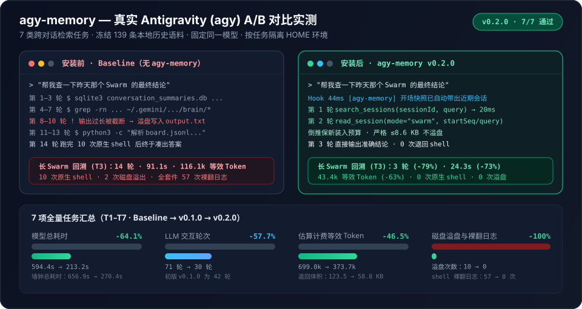
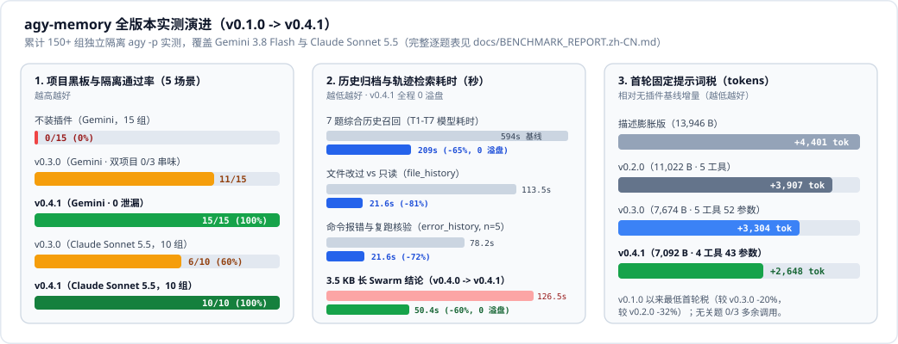
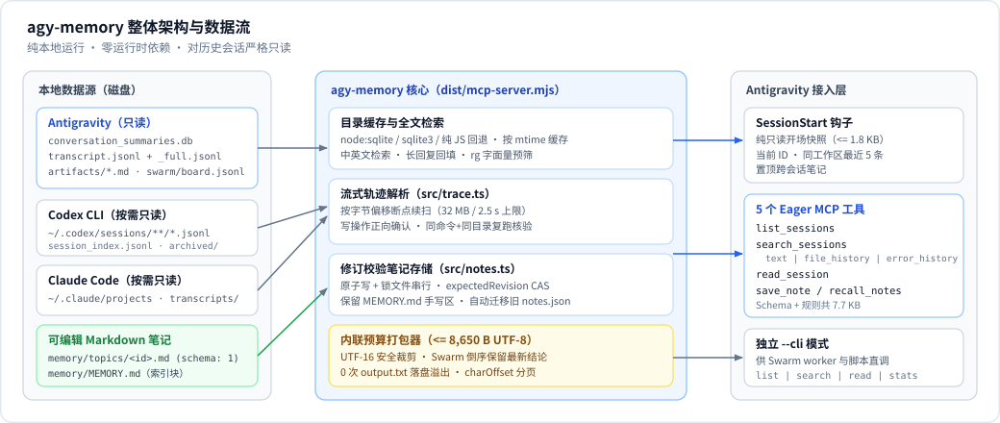

# agy-memory

[English](./README.md)

[](https://github.com/maxLWS/agy-memory/actions/workflows/ci.yml)
[](https://github.com/maxLWS/agy-memory/releases)
[](LICENSE)
[](https://glama.ai/mcp/servers/maxLWS/agy-memory)

在 Google Antigravity 的同一个 Project 里新开会话 B，它完全不知道会话 A 五分钟前刚定下的约定。让它查一下昨天 `pytest` 为什么挂了，它往往花上十几轮去裸 grep 几十 MB 的 JSONL 日志。

**agy-memory** 用一个纯本地、零依赖插件同时解决这两件事（覆盖 Antigravity `App`、`CLI` 与 `IDE`）。同项目新开会话在 Turn 0 直接拿到当前生效的 Markdown 黑板，底层辅以对本机历史对话、文件写读记录、命令报错复跑与 Swarm 留言板的只读检索。不上云、不建向量库、也不调后台 LLM。

已收录于 [Awesome Antigravity Plugins](https://github.com/biTQ-m/awesome-antigravity-plugins/blob/main/README_CN.md#性能加速工程流与多智能体编排) 的「性能加速、工程流与多智能体编排」分类。



## 10 秒安装

需要 **Node.js 20 及以上**，`dist/` 已包含单文件预构建产物，无需 `npm install`。

**macOS 与 Linux**

```bash
curl -fsSL https://raw.githubusercontent.com/maxLWS/agy-memory/main/install.sh | sh
```

**Windows (PowerShell)**

```powershell
irm https://raw.githubusercontent.com/maxLWS/agy-memory/main/install.ps1 | iex
```

<details>
<summary>手动安装、单项目安装与迁移 v0.3 旧笔记</summary>

```bash
git clone https://github.com/maxLWS/agy-memory.git && cd agy-memory
node scripts/install.mjs install                       # 全局安装（~/.gemini/config/plugins/agy-memory）
node scripts/install.mjs install --project /path/repo  # 仅安装到单个仓库
node scripts/install.mjs doctor                        # 校验 MCP 握手、钩子与 agy --strict

# 可选：无损导入 v0.3 的 topics/*.md 或 notes.json（原文件保持只读不动）
node ~/.gemini/config/plugins/agy-memory/dist/mcp-server.mjs --cli migrate-notes --scope global
```

</details>

装完后新开一条 Antigravity 会话即可生效。

## `v0.4.1` 带来的三大变化

- **Turn 0 共享项目黑板，同目录双项目绝不串味。** 命名项目严格按 `project_id` 隔离（新会话尚未入汇总库前直接从 `conversations/<id>.db` 读取 Protobuf 字段 18），两个共用同一仓库目录的 Project 互不泄漏；普通 CLI 自动合并多个 Git linked worktree。
- **原生溯源能力全部保留，Swarm 长消息不再截断。** 自动从 `transcript_full.jsonl` 补全被截断的长回复，核验文件到底是被改过还是只读过（`mode="file_history"`），回查命令报错退出码与后续复跑结果（`mode="error_history"`），并在 `v0.4.1` 放开单条 Swarm 消息 1,400 字硬截断。
- **比以往所有版本都更轻。** 砍掉 Codex/Claude 适配器、旧版全局锁笔记和独立 `list_sessions` 后，收敛为 **4 个工具**、**源码较 `v0.3.0` 净减 341 行**（`6,309 -> 5,968`）、启动钩子中位 **58.5 ms**，并把首轮提示词税压到 **`v0.1.0` 以来最低**（较 `v0.3.0` 降 20%，较 `v0.2.0` 降 32%）。

## 全版本实测演进（`v0.1.0` -> `v0.4.1`）



累计 **150+ 组真实隔离 `agy -p` 运行**（覆盖 `gemini-3.8-flash-medium` 与 `claude-sonnet-5-5-medium`）：

| 版本 | 历史归档综合召回（`T1–T7`） | 文件 / 报错 / Swarm 溯源 | 项目黑板与隔离（`B1–B5`） | 首轮提示词税 |
| :--- | :--- | :--- | :--- | :--- |
| **不装插件** | `594.4s` 模型耗时，`699k` tok，`10` 次溢盘 | `file`：`113.5s` · `error`：`78.2s`（`v0.3` 补提示前） · Swarm：超时（`125.7s`） | `0/15`（0%） | 基线（`9,617` tok） |
| **`v0.2.0`** | **`213.2s`（-64%）**，`374k` tok，**`0` 溢盘** | 无 trace 模式（`90.0s`） | 无 `project_id` 黑板 | `+3,907` tok（`11,022 B`） |
| **`v0.3.0`** | **`208.7s`（-65%）**，`375k` tok，**`0` 溢盘** | `file`：**`21.6s`** · `error`：**`21.6s`** · Swarm：超时（`126.0s`） | Gemini `11/15`、Claude `6/10`（**双项目隔离 `0/5` 通过，`5/5` 串味**） | `+3,304` tok（`7,674 B`） |
| **`v0.4.1`** | 全部保留（`T7` `44.7s`、`T9` `16.9s`、`0` 溢盘） | **`file`/`error` 保留 + Swarm `50.4s` / `5` 轮 / `0` 溢盘** | **Gemini `15/15`、Claude `10/10`（双项目 `5/5` 零泄漏）** | **`+2,648` tok（`7,092 B`，4 工具）** |

完整逐题对比、中位数与区间以及 `v0.1.0 -> v0.4.1` 每次排障复盘见 [docs/BENCHMARK_REPORT.zh-CN.md](./docs/BENCHMARK_REPORT.zh-CN.md)。

## 磁盘上与会话里长什么样

会话 A 调用 `board_post` 后，会在本地落下一个你随时可以手改的普通 Markdown 文件：

```markdown
<!-- ~/.gemini/agy-memory/boards/project_api-v2_<hash>/entries/retry-policy.md -->
---
schema: 1
key: "retry-policy"
title: "HTTP retry policy"
updatedAt: "2026-11-26T04:10:00.000Z"
sourceClient: "cli"
sourceSession: "a629d4f8-1a06-45a6-8a35-0f4a175c64f3"
---

Use `retry_backoff_ms=450`, header `X-Epoch-812`, and `max_batch=32`.
```

你在同项目下新开会话 B 时，`SessionStart` 在 `<= 1,536` UTF-8 字节内整条内联黑板（超出时自动切到整 key 目录，绝不从条目中间截断）：

```text
[agy-memory] session=51459fb0 (id=51459fb0-..., scope=project/api-v2)
Project board (1 active, inline):
## retry-policy — HTTP retry policy (rev=e6aa61696c47 · 2h ago · from a629d4f8)
Use `retry_backoff_ms=450`, header `X-Epoch-812`, and `max_batch=32`.
```



## 4 个工具与作用域隔离

| 工具 | 职责 |
| :--- | :--- |
| `board_read` | 读取当前项目或全局黑板条目（`project`、`global`、`all`），返回 `Revision` 与文件 `Path`。 |
| `board_post` | 创建、覆写或删除单个 key（更新与删除强制 `expectedRevision`，每 key 独立 `linkSync` 原子锁与死进程锁回收）。 |
| `search_sessions` | 省略 `query` 列出近期会话，或检索历史正文、Artifacts 与 Swarm 看板（`text`、`file_history`、`error_history`）。传 `conversationId` 锁定当前项目并排除当前会话，跨项目显式传 `allScopes=true`。 |
| `read_session` | 深度查看单条会话（`digest`、自动补全 `transcript_full.jsonl` 的 `turns`、`artifacts`、支持单条满预算读取的 `swarm`），输出严守 `<= 8,650` UTF-8 字节内联不溢盘。 |

作用域固定解析为五类不相交空间：`project/<projectId>`（跨 App/CLI/IDE 聚合，同目录多项目隔离）、`cli_repo/<gitCommonDir>`（零子进程合并 Git linked worktree）、`cli_workspace/<realpath>`、`global` 与 fail-closed 的 `unresolved`。

## 明确不做什么

- **不做后台 LLM 自动总结。** 会话 A 没调 `board_post` 时黑板不会猜测编造，会话 B 靠开场 1 行活跃兄弟提示（设 `AGY_MEMORY_SIBLING_HINT=0` 可关闭）和 `search_sessions` 回查原日志兜底。
- **不再适配 Codex 与 Claude Code。** 已在 `v0.4.0` 移除，把隔离语义、轨迹核验与工具面全部聚焦在 Antigravity 上。
- **首轮固定前缀成本真实存在。** 挂载 4 个 eager 工具在 Gemini 首轮约多占 2,648 tokens。纯一次性独立目录建议用 `--project` 单项目安装。

## 命令行调用与本地开发

Swarm worker 默认不挂载 MCP，可直接通过 `--cli` 调用同一个单文件产物：

```bash
node ~/.gemini/config/plugins/agy-memory/dist/mcp-server.mjs --cli board-read --scope global
node ~/.gemini/config/plugins/agy-memory/dist/mcp-server.mjs --cli board-post --scope project/<id> --key cache-ttl --body "Keep mutex TTL at 15s"
node ~/.gemini/config/plugins/agy-memory/dist/mcp-server.mjs --cli search --conversation <uuid> "rate limiter"
node ~/.gemini/config/plugins/agy-memory/dist/mcp-server.mjs --cli search --all-scopes --mode file_history "utils.py"
node ~/.gemini/config/plugins/agy-memory/dist/mcp-server.mjs --cli search --all-scopes --mode error_history "pytest"
node ~/.gemini/config/plugins/agy-memory/dist/mcp-server.mjs --cli read a1b2c3d4 --mode swarm --start-seq 79 --end-seq 79
```

```bash
npm install
npm run typecheck && npm run build && npm test && npm run bench:stress && npm run validate
```

与 `agy-fast` 插件目录与钩子互不冲突，全程零网络外联。详见 [CHANGELOG.md](./CHANGELOG.md)、[SECURITY.md](./SECURITY.md) 与 [MIT LICENSE](./LICENSE)。
